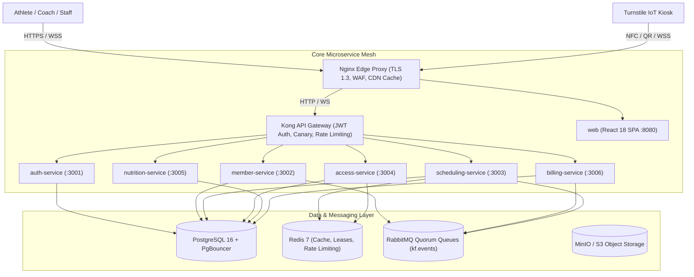

# KineticFit OS - Enterprise System Architecture & Blueprint

KineticFit OS is a production-grade multi-branch gym management and telemetry operating system engineered for athletic facilities, boutique fitness franchises, and performance sports institutes.

---

## 1. System Context & C4 Container Architecture

---

## 2. Microservice Domains & Boundaries

1. **`auth-service`**:
   - Ed25519 token signing, JWKS distribution, multi-key rotation, Google OIDC PKCE flow.
   - Refresh token family rotation with automatic revocation upon reuse detection.
   - Fine-grained RBAC and ABAC tenant isolation.
2. **`member-service`**:
   - Athlete directory, lifecycle states (ACTIVE, EXPIRING, FROZEN, SUSPENDED).
   - Orchestrates the 4-step Registration Distributed Saga with reverse compensations.
   - Keyset cursor pagination for 100k+ member scalability.
3. **`scheduling-service`**:
   - Class timetable, studio capacity management (MetCon, Yoga, Cycle, Oly Lifting).
   - High-concurrency booking engine with pessimistic row locking (`FOR UPDATE SKIP LOCKED`) guaranteeing 0 oversold seats under 200 concurrent race requests.
4. **`access-service`**:
   - Turnstile telemetry state machine (OFFLINE -> SCANNING -> VALIDATING -> UNLOCKED -> REJECTED -> ALARM).
   - Rotating 60s TOTP QR digital pass verification and live occupancy presence streaming over WebSockets.
5. **`nutrition-service`**:
   - Chrono-nutritional timeline generator (pre/post-workout meal timing).
   - Mifflin-St Jeor TDEE & macro calculator.
   - InBody 770 composition tracking with immutable protocol versioning (`v1` -> `v2`).
6. **`billing-service`**:
   - Tiered subscription lifecycle ($129 Standard, $199 Performance, $289 VIP Elite).
   - Pluggable payment providers (`StripeProvider`, `RazorpayProvider`, `MockPaymentProvider`).
   - HMAC webhook verification with 300s replay window rejection and automated dunning retries.
7. **`fn-pdf-export`**:
   - Stateless function container generating PDF Meal Guides, Landscape Timetables, Invoices, and sanitized CSV exports without headless browser overhead.

---

## 3. Distributed Transactions: Saga Pattern & Outbox

KineticFit OS strictly avoids Two-Phase Commit (2PC) in favor of distributed choreography and orchestration Sagas:
- **Transactional Outbox**: State changes and event publications occur within the same PostgreSQL ACID transaction. A background publisher sweeps outbox rows and acknowledges RabbitMQ messages.
- **Reverse Compensations**: If any downstream step fails (e.g. payment decline after member record created), compensation commands undo previous steps in reverse order.
- **Dead Letter Queues**: Poisoned messages route to `*.dlq` with replay/discard controls on the in-app `/system` dashboard.
